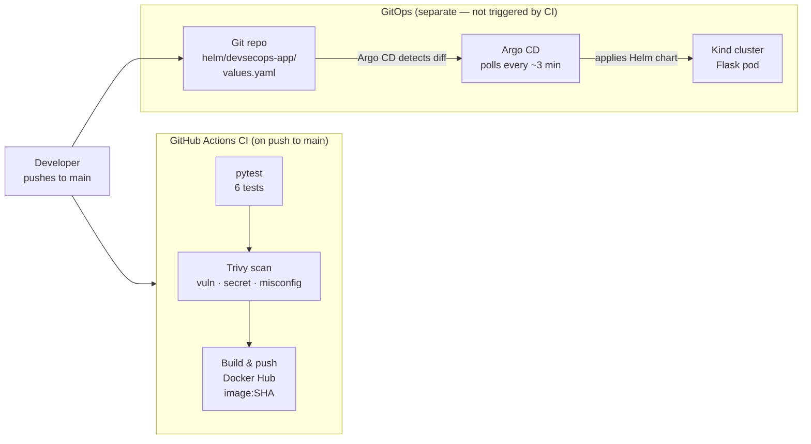

# Cloud-Native DevSecOps & GitOps Delivery Platform

An end-to-end DevSecOps and GitOps pipeline: automated testing, container security scanning, Docker Hub image publishing, and Git-driven Kubernetes deployment via Argo CD. Built as an eight-phase project demonstrating production-conscious practices on a local Kind cluster.

**Technologies:** Python · Flask · Gunicorn · Docker · GitHub Actions · Trivy · SonarCloud (optional) · Helm · Kind · Argo CD

---

## Architecture



> **Note:** CI publishes a new image to Docker Hub on every push to `main`. Argo CD watches the Helm chart in Git and deploys whatever image tag is specified in `values.yaml`. Publishing a new image does **not** automatically update `values.yaml` or trigger a new deployment — that step requires a separate Git commit changing the image tag.

---

## Repository structure

```
.
├── app/
│   └── __init__.py               # Flask app factory — routes /, /health, /api/health
├── tests/
│   └── test_routes.py            # 6 pytest tests
├── helm/devsecops-app/           # Helm chart (managed by Argo CD)
│   ├── Chart.yaml
│   ├── values.yaml               # image.repository, image.tag, replicaCount
│   └── templates/
│       ├── deployment.yaml       # Deployment with pod + container securityContext
│       ├── service.yaml          # ClusterIP, port 80 → targetPort 5000
│       └── _helpers.tpl
├── argocd/
│   ├── application.yaml          # Argo CD Application manifest
│   └── appproject-default.yaml   # Default AppProject (required by core install)
├── .github/workflows/ci.yml      # CI pipeline: test → Trivy scan → Docker Hub publish
├── Dockerfile                    # python:3.12-slim, Gunicorn, non-root user
├── requirements.txt              # flask==3.1.1, gunicorn==23.0.0, pytest==8.3.5
├── run.py                        # Local dev entry point
├── sonar-project.properties      # SonarCloud configuration (optional)
└── docs/gitops.md                # Argo CD setup and reconciliation walkthrough
```

---

## Local prerequisites

- Python 3.12+
- Docker
- [Kind](https://kind.sigs.k8s.io/) v0.20+
- [kubectl](https://kubernetes.io/docs/tasks/tools/)
- [Helm](https://helm.sh/docs/intro/install/) v3.12+

---

## Local commands

### Run tests

```bash
pip install -r requirements.txt
python -m pytest -v
```

### Run the application (dev server)

```bash
python run.py          # http://localhost:5000
```

### Build and run with Docker

```bash
docker build -t devsecops-app:local .
docker run -p 5000:5000 devsecops-app:local
curl http://localhost:5000/health
```

### Deploy with Helm to Kind (standalone — without Argo CD)

```bash
kind create cluster --name devsecops
kind load docker-image devsecops-app:local --name devsecops
helm install devsecops-app helm/devsecops-app --kube-context kind-devsecops --wait
kubectl port-forward svc/devsecops-app 8080:80 -n default
curl http://localhost:8080/health
```

> The Helm release name is `devsecops-app`, so the Service is named `devsecops-app`.

### Deploy with Argo CD GitOps

See [`docs/gitops.md`](docs/gitops.md) for the full walkthrough. Quick-start:

```bash
# Install Argo CD core into the cluster
kubectl create namespace argocd
kubectl apply -n argocd \
  -f https://raw.githubusercontent.com/argoproj/argo-cd/v2.13.1/manifests/core-install.yaml

# Bootstrap and apply the Application
kubectl apply -f argocd/appproject-default.yaml
kubectl apply -f argocd/application.yaml

# Check sync status
kubectl get application devsecops-app -n argocd
# NAME            SYNC STATUS   HEALTH STATUS
# devsecops-app   Synced        Healthy

# Access via port-forward
kubectl port-forward svc/devsecops-app 8080:80 -n default
curl http://localhost:8080/health
```

---

## GitHub secrets and variables

Configure in **Settings → Secrets → Actions** and **Settings → Variables → Actions**:

| Name | Type | Purpose |
|---|---|---|
| `DOCKERHUB_USERNAME` | Secret | Docker Hub account name |
| `DOCKERHUB_TOKEN` | Secret | Docker Hub access token (Personal Access Token) |
| `SONAR_TOKEN` | Secret | SonarCloud authentication token (optional) |
| `SONAR_ENABLED` | Variable | Set to `true` to enable SonarCloud analysis |

Never commit secret values. The workflow reads them exclusively from GitHub secrets/variables.

---

## Verification results

### Local (verified)

| Check | Result |
|---|---|
| `pytest -v` | ✅ 6/6 passed |
| `helm lint` | ✅ 0 failures |
| `docker build` | ✅ Builds `devsecops-app:local` |
| Container endpoints | ✅ `/`, `/health`, `/api/health` → HTTP 200 |
| Trivy local fs scan | ✅ 0 HIGH/CRITICAL (pip deps + Dockerfile) |
| Argo CD sync | ✅ `Synced` + `Healthy` observed |
| GitOps reconciliation | ✅ `replicaCount` 1→2→1 auto-synced and pruned |
| Pod health after security-context change | ⚠️ Not re-verified after commit `93adcce` — confirm with `kubectl get pods` |

### Hosted GitHub Actions (latest run)

| Job | Result |
|---|---|
| `test` | ✅ Passed |
| `scan` (Trivy) | ✅ Passed — 0 HIGH/CRITICAL findings |
| `publish` (Docker Hub) | ✅ Passed — image pushed to Docker Hub |
| SonarCloud | ⏭ Skipped — `SONAR_ENABLED` not set |

CI publishes images tagged with the full Git commit SHA (`<username>/devsecops-app:<sha>`).

---

## Troubleshooting

**Tests fail with import error**
```bash
pip install -r requirements.txt
```

**Pod stuck in `ImagePullBackOff`**
`values.yaml` defaults to `devsecops-app:local` with `imagePullPolicy: IfNotPresent`.
Load the image before deploying:
```bash
kind load docker-image devsecops-app:local --name devsecops
```

**Pod `CrashLoopBackOff` with `readOnlyRootFilesystem`**
Gunicorn may need `/tmp`. Add a `tmpfs` emptyDir volume:
```yaml
volumes:
  - name: tmp
    emptyDir: {}
volumeMounts:
  - mountPath: /tmp
    name: tmp
```

**Argo CD Application stays `Unknown`**
The `default` AppProject is not created by core-install. Apply it manually:
```bash
kubectl apply -f argocd/appproject-default.yaml
```

**Argo CD does not sync after a push**
Default polling interval is ~3 minutes. Trigger a manual sync:
```bash
kubectl patch application devsecops-app -n argocd \
  --type merge -p '{"operation":{"initiatedBy":{"username":"admin"},"sync":{"revision":"HEAD"}}}'
```

**Docker Hub login fails with `malformed HTTP Authorization header`**
The `DOCKERHUB_USERNAME` or `DOCKERHUB_TOKEN` secret may contain leading/trailing whitespace introduced during paste. Re-enter both secrets in Settings → Secrets → Actions by typing the username and pasting the token fresh from the Docker Hub Access Tokens page.

---

## Limitations

- **Kind is local only.** No cloud cluster is provisioned. To deploy a CI-published image, update `image.tag` in `values.yaml` to the desired commit SHA and push to `main`.
- **Image promotion is manual.** CI publishes a new image on every push to `main`, but Argo CD deploys only what `values.yaml` specifies. There is no automated image-tag updater.
- **Argo CD core install** omits the web UI and Dex (SSO). All management is via `kubectl`.
- **SonarCloud** is optional and not yet enabled. Set `SONAR_ENABLED=true` and `SONAR_TOKEN` to activate it, and update `sonar-project.properties` with your organization and project key.
