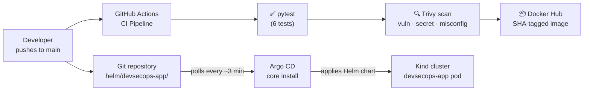

# Cloud-Native DevSecOps & GitOps Delivery Platform

A minimal but complete end-to-end DevSecOps pipeline built over eight phases in a single day.

**Technologies:** Python · Flask · Gunicorn · Docker · GitHub Actions · Trivy · SonarCloud (optional) · Helm · Kind · Argo CD

---

## Architecture



---

## Repository structure

```
.
├── app/                          # Flask application package
│   └── __init__.py               # App factory + routes (/, /health, /api/health)
├── tests/
│   └── test_routes.py            # 6 pytest tests
├── helm/devsecops-app/           # Helm chart
│   ├── Chart.yaml
│   ├── values.yaml
│   └── templates/
│       ├── deployment.yaml       # Deployment with security context
│       ├── service.yaml          # ClusterIP service
│       └── _helpers.tpl
├── argocd/
│   ├── application.yaml          # Argo CD Application manifest
│   └── appproject-default.yaml   # Default AppProject (core install bootstrap)
├── .github/workflows/ci.yml      # CI: test → Trivy scan → Docker Hub publish
├── Dockerfile                    # python:3.12-slim, Gunicorn, non-root user
├── requirements.txt              # flask, gunicorn, pytest
├── run.py                        # Local dev entry point
├── sonar-project.properties      # SonarCloud config (optional)
└── docs/gitops.md                # Argo CD setup and reconciliation guide
```

---

## Local prerequisites

- Python 3.12+
- Docker
- [Kind](https://kind.sigs.k8s.io/) v0.20+
- [kubectl](https://kubernetes.io/docs/tasks/tools/)
- [Helm](https://helm.sh/docs/intro/install/) v3.12+

---

## Local commands

### Run tests

```bash
pip install -r requirements.txt
python -m pytest -v
```

### Run the application

```bash
python run.py          # Flask dev server on http://localhost:5000
```

### Build and run with Docker

```bash
docker build -t devsecops-app:local .
docker run -p 5000:5000 devsecops-app:local
curl http://localhost:5000/health
```

### Deploy with Helm to Kind

```bash
kind create cluster --name devsecops
kind load docker-image devsecops-app:local --name devsecops
helm install devsecops helm/devsecops-app --kube-context kind-devsecops --wait
kubectl port-forward svc/devsecops 8080:80
curl http://localhost:8080/health
```

### Verify Argo CD GitOps

See [`docs/gitops.md`](docs/gitops.md) for full setup. Quick status check:

```bash
kubectl get application devsecops-app -n argocd
# NAME            SYNC STATUS   HEALTH STATUS
# devsecops-app   Synced        Healthy
```

---

## GitHub secrets and variables

Configure these in **Settings → Secrets → Actions** and **Settings → Variables → Actions**:

| Name | Type | Purpose |
|---|---|---|
| `DOCKERHUB_USERNAME` | Secret | Docker Hub account name |
| `DOCKERHUB_TOKEN` | Secret | Docker Hub access token |
| `SONAR_TOKEN` | Secret | SonarCloud authentication token (optional) |
| `SONAR_ENABLED` | Variable | Set to `true` to enable SonarCloud analysis |

Never commit secret values. The workflow reads them exclusively from GitHub secrets/variables.

---

## Verification results

### Local (verified)

| Check | Result |
|---|---|
| `pytest -v` | ✅ 6/6 passed |
| `helm lint` | ✅ 0 failures |
| `docker build` | ✅ Builds `devsecops-app:local` |
| Container endpoints | ✅ `/`, `/health`, `/api/health` → HTTP 200 |
| Trivy local fs scan | ✅ 0 HIGH/CRITICAL (pip deps + Dockerfile) |
| Argo CD sync | ✅ `Synced` + `Healthy` observed |
| GitOps reconciliation | ✅ `replicaCount` 1→2→1 auto-synced and pruned |

### Hosted GitHub Actions

| Job | Latest result |
|---|---|
| `test` | ✅ Passed |
| `scan` (Trivy) | ❌ Failed — 3 HIGH misconfigs in Helm deployment template (fixed in current commit) |
| `publish` (Docker Hub) | ⏭ Skipped (scan failed) |

**Trivy findings fixed:** Added `securityContext` (pod + container) with `runAsNonRoot`, `readOnlyRootFilesystem`, `allowPrivilegeEscalation: false`, and `capabilities.drop: [ALL]`.

Docker Hub image publishing remains unverified until a CI run completes all three jobs successfully.

---

## Troubleshooting

**Tests fail with import error**
```bash
pip install -r requirements.txt   # ensure Flask is installed
```

**Pod stuck in `ImagePullBackOff`**
The default `values.yaml` uses `devsecops-app:local` with `imagePullPolicy: IfNotPresent`.
Load the image into Kind before deploying:
```bash
kind load docker-image devsecops-app:local --name devsecops
```

**Pod `CrashLoopBackOff` with readOnlyRootFilesystem**
Gunicorn may need `/tmp`. Add a `tmpfs` emptyDir volume if needed:
```yaml
volumes:
  - name: tmp
    emptyDir: {}
volumeMounts:
  - mountPath: /tmp
    name: tmp
```

**Argo CD Application stays `Unknown`**
The `default` AppProject is not created by core-install. Apply it manually:
```bash
kubectl apply -f argocd/appproject-default.yaml
```

**Argo CD does not sync after a push**
Default polling interval is ~3 minutes. Wait or trigger a manual sync:
```bash
kubectl patch application devsecops-app -n argocd \
  --type merge -p '{"operation":{"initiatedBy":{"username":"admin"},"sync":{"revision":"HEAD"}}}'
```

---

## Limitations

- **Kind is local only.** No cloud cluster is provisioned. The Docker Hub image tag used in production deployments requires a successful CI publish run.
- **Argo CD core install** omits the web UI and Dex (SSO). Management is via `kubectl` only.
- **SonarCloud** is optional and not yet enabled. Configure `SONAR_ENABLED=true` and `SONAR_TOKEN` to activate it.
- **Docker Hub publishing** has not been verified by a successful hosted CI run. The `publish` job requires all prior jobs to pass first.
